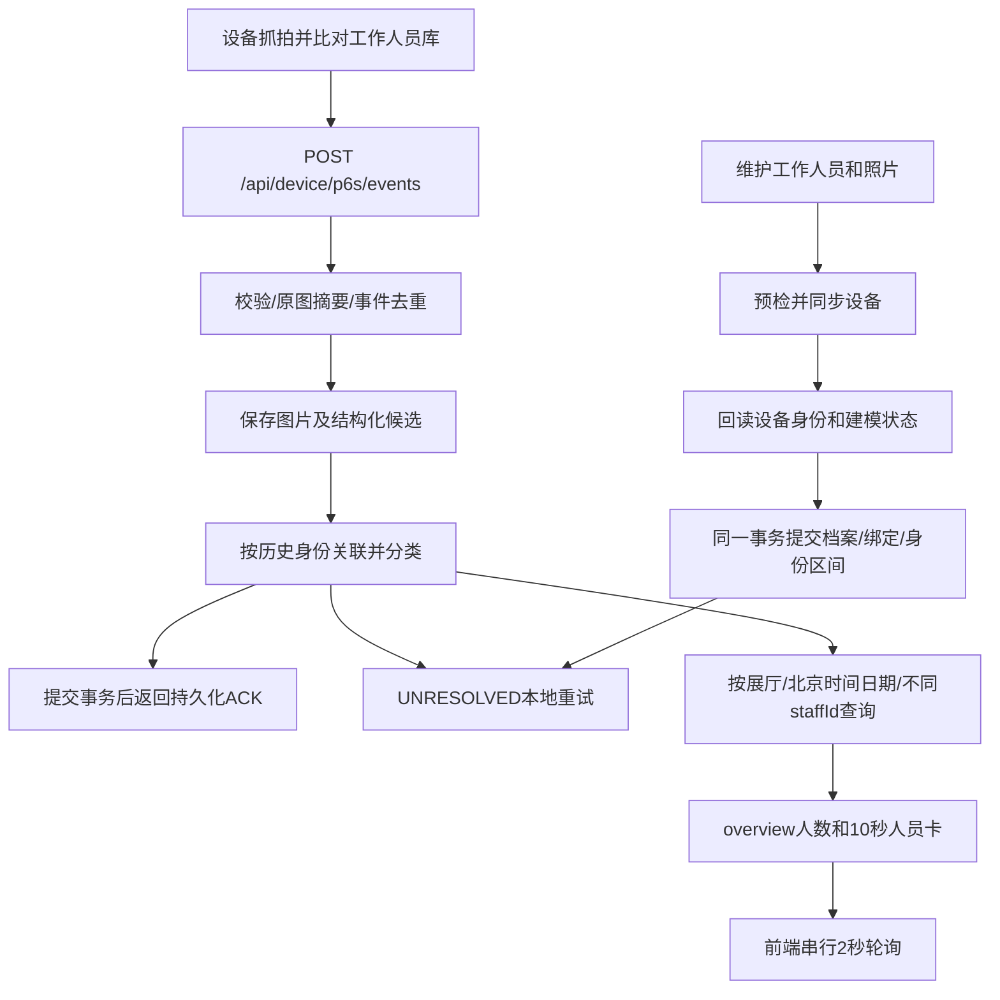

# 工作人员设备比对与大屏接入

<!-- @author MoShangHuaKai -->

本文对应本次实现：Java 8 / Spring Boot 2 / MyBatis / MySQL 5.7，单实例、单台工作人员同步设备。设备比对继续确认工作人员；新增的独立本机模型提取人脸向量，由Java维护所有人员当天去重。当前现场已在验证和用户确认后启用，启用步骤和前端字段见[大屏交接说明](monitor-frontend-handoff.md)。

## 1. 完成范围与上线前提

回调、图片及结果持久化、身份历史、本地重新关联、查询、大屏日去重和前端示例已实现。代码默认`exhibition.recognition.enabled=false`；2026-11-06现场配置已设置为true，同时启用工作人员日统计和心跳`isPersonInfoEnable`识别上报。关闭时上报也关闭，普通抓拍开启，客流关闭。未核实的FaceReco保留诊断样本；ACK未核实时返回503，不能持续开展生产上报。

2026-11-06现场验证：设备HTTP平台旧地址192.168.2.100已更正为当前电脑192.168.2.33:8080，路径`/api/device/p6s/events`、认证none、超时10秒。真实报文的personId和uniqueId均等于已绑定FaceUUID，personType等于工作人员库GroupID2；ACK按字符串回显UUID。修复了固件`data:image/jpg;base64,`图片前缀及空库图前缀被拒收的问题，图片MD5仍按原始解码字节校验。建立1名工作人员身份基线后启用识别，10:38:47的xiaoyu事件匹配92.681625分，overview返回staffCount=1及最新人员卡，10秒后卡片清空、人数保留。后台统计阈值为80分，设备脸库阈值未修改。电脑IP变化时须同步更新设备回调地址。

本轮Java 8完整构建通过：120项测试，119通过、1项实体视频测试跳过，0失败、0错误。证据为`target/screen-recognition-fix-build.log`和`target/screen-recognition-live-verification.json`。当前后台使用已构建JAR运行；设备主动管理请求使用本机HTTP代理127.0.0.1:7890绕开直连超时，本机接口不走代理。下述2026-11-05记录仅描述当日状态。

2026-11-05真机只读检查：识别基础开关true；规则CompareLimit=1、Push=true、AllDay=true，但`FaceGroupList.ControlPersonnelType=None`且没有选中库；目标库GroupID=0、阈值0、有效人员1。这些值仅描述检查时状态，不代表识别已可用。本轮未修改真机配置、脸库或工作人员，未获得真实FaceReco样本。

启用前须确认实际通道、工作人员目标库及有效阈值、回调身份与人员列表的关系，以及命中/未匹配ACK字段、类型和停止重传效果。不能用姓名、工号或照片文件名代替设备身份核实。

## 2. 完整流转和取数位置



| 所需数据 | 获取接口或位置 | 用途 |
|---|---|---|
| 能力和通道 | GET /System/DeviceCap，支持时GET /System/AICap | 确认真机支持，不能只看资料 |
| 目标库及阈值 | PUT /FaceGroups/QueryAll（查询） | 记录GroupID2、数字GroupID、库名、阈值 |
| 人员身份 | PUT /FaceGroup/QueryPersonInfoList（查询） | 回读FaceUUID、PersonID、UniqueID（如有）、ModelState |
| 开关及规则 | GET /FaceReco/{ChannelID}/BaseConfig和RecoRuleList | 目标库、候选上限1、推送及布防时段 |
| 抓拍配置 | GET /AI/FaceSnapshotCfg及设备HTTP平台页面 | 质量、背景图、回调IP/端口/路径/超时 |
| 实际事件 | 后端回调及抓拍详情 | 查看personInfo、无Base64协议、分类原因及ACK |
| 人数及最新人员 | GET /api/screen/overview | 前端不直连设备，也不逐人查询档案 |

设备回调：`POST http://后端IP:实际端口/api/device/p6s/events`，Content-Type为application/json。前端`/#/monitor`不是回调地址。请求体上限4MB，每张解码图片最多768KiB、Base64约1MiB；原图MD5针对收到的原始解码字节校验。

## 3. 安装及启用顺序

1. 停止待升级应用、备份数据库。新库只执行`sql/schema.sql`；调整前已有结构只执行一次`sql/recognition-upgrade.sql`，不要同时执行。不会自动迁移、清空档案、上传照片或回填旧抓拍。MySQL5.7整份DDL脚本不是原子事务，执行前核对结构。
2. 部署后端，保持enabled=false。`GET /api/admin/recognition/device-diagnostics`返回只读能力/规则XML，通道取recognition.channel-id（默认1）；不支持的能力返回该项诊断，不阻止其他查询。
3. 受控采集命中、未匹配及异常候选，核实ACK后配置ack-verified和类型，实测停止重传。`docs/examples/face-reco-synthetic.json`是模拟样例，不能当作真实协议证据。
4. 明确identity-field/identity-source/group-field/group-value及现场阈值；设置protocol-verified=true，仍保持enabled=false，重启生效。
5. `POST /api/admin/recognition/baseline`只读回查所有已绑定人员，并事务保存本地基线。响应data.verifiedCount为核实数量。任意人员缺失、字段缺失、重复身份时整批不更新；不按姓名配对。详情deviceBinding返回建模原值与核实时间；空状态或上传成功不等于建模成功。
6. 命中及未匹配ACK均完成真机验证后，才设置enabled=true并重启。启动校验契约及基线，持久化首次启用时间，再允许心跳打开识别上报。重启不重置启用时间。
7. 验证首次命中计1、重复仍1、新人换卡、10秒清空、补传补发生日而不重弹旧卡。离线保留已形成数量并提示采集已中断。

配置模板（空值用真机核实值替换，不预设身份对应或阈值）：

```yaml
exhibition:
  recognition:
    enabled: false
    protocol-verified: false
    ack-verified: false
    channel-id: 1
    identity-field: ''           # personId或uniqueId，选一种
    identity-source: ''          # FACE_UUID、PERSON_ID、UNIQUE_ID，选已证实来源
    group-field: personType      # 或验证过的groupId
    group-value: ''              # 回调中工作人员库的实际值，不猜测等于GroupID2
    min-similarity: null         # 已核实的(0,100]分数阈值，分数不是概率
    ack-person-id-type: STRING   # 或INTEGER，须实测
    unmatched-person-id: '0'     # 待验证占位值
    unmatched-unique-id: ''      # 待验证占位值
```

识别配置修改后重启，不热更新。先核实协议、再建基线、最后启用。基线从核实时刻开始，不推测更早归属。

## 4. 后端处理和存储

`exh_staff_device`保存当前绑定、库编号、设备身份、选定字段、建模状态及核实时间；`exh_device_identity`保存设备+回调库+选定字段+身份值的左闭右开区间`[validFrom,validUntil)`。停用/删除关闭区间，补传按发生时间关联。人员维护沿用先设备成功、后本地事务、失败逆序补偿；新身份起点为设备写入开始时间，首次基线为核实时间。

`exh_capture_event`保存事件类型、展厅、候选数、分数、身份、staffId及姓名/工号/职位/部门/登记照快照、原图MD5、去图片协议、ACK及重试状态。已确认快照不随档案修改而改写。详情返回完整候选，列表不返回协议和ACK。

| matchStatus | 含义 | 计人数 |
|---|---|---|
| NOT_COMPARED | FaceSnapshot，没有比对结果 | 否 |
| STAFF | 单候选、达阈值、目标库正确，按发生时间唯一关联 | 是 |
| NO_MATCH | 明确matchNumber=0且没有矛盾候选 | 否 |
| UNRESOLVED | 身份存在但历史映射缺失或冲突 | 否 |
| REVIEW | 未启用/未验收、多候选、分数异常或不足、库不符、业务矛盾 | 否 |

`status=RECEIVED/EXPIRED`与matchStatus独立。NO_MATCH不自动成为访客或新增人员；候选数不是人数，分数不是准确率。缺少有效阈值不能启用。

幂等键含设备、类型、事件编号、发生时间、trackId、原始抓拍SHA-256；FaceReco还含固定顺序候选身份。FaceSnapshot与FaceReco分别保存。并发重复由唯一索引拦截，失败事务撤销图片及元数据，再读成功记录。ACK保存快照供重传复用；数据库或必需图片失败不返回成功ACK。ACK未验证时先提交诊断事件再返回503。回调中不查设备。

重新关联每30秒、每批最多200条、自动最多3次；对应映射提交后重新激活该身份的未解决事件。状态持久化，重启继续；行锁保护定时与人工操作。人工resolve只处理UNRESOLVED，不覆盖STAFF、不写设备。

日统计：当前hallId+北京时间发生日+FaceReco+RECEIVED+STAFF+启用后，`COUNT(DISTINCT staff_id)`。不建每日汇总表、不累加；后来停用/删除不扣人数，跨日补传补发生日。启用后无记录为0，关闭为null。

沿用30天保留及日清理。被事件引用的抓拍、背景、库图和登记照不提前作为无引用媒体删除；到期先解除业务引用再清理媒体。超期限补传为EXPIRED、不存图。已关闭身份历史至少覆盖允许补传窗口。

## 5. 接口契约

普通接口`{code,message,data}`；ACK及图片各用原生格式。沿用当前直接访问方式，不新增Authorization机制。

| 方法与接口 | 参数/返回 |
|---|---|
| POST /api/device/p6s/events | heartbeat、FaceSnapshot、FaceReco；提交后ACK |
| GET /api/admin/staff/{id} | 原字段外增加只读deviceBinding |
| GET /api/admin/captures | date/deviceSn/status/eventType/matchStatus/staffId/page/size；data数组、最多100条、无总数 |
| GET /api/admin/captures/{id} | protocol候选、图片引用、ACK、重试状态 |
| POST /api/admin/captures/{id}/resolve | 本地重关联，返回最新详情 |
| GET /api/admin/recognition/device-diagnostics | 设备能力和规则只读诊断 |
| POST /api/admin/recognition/baseline | 只读回查设备，事务更新本地身份基线 |
| GET /api/screen/config | hallName、welcomeMessage |
| GET /api/screen/overview | 人数、状态、最新人员快照 |
| GET /api/media/{id} | 图片二进制，可直接img src |

列表示例：`GET /api/admin/captures?date=2026-11-05&eventType=FaceReco&matchStatus=STAFF&page=1&size=20`。每条含id/eventType/deviceSn/eventId/businessDate/eventTime/receivedAt/status/matchStatus/matchReason/matchNumber/similarity/imageId/recognizeImageId/backgroundId/staff。staff为事件快照`{id,staffNo,name,position,department,avatarId}`或null。识别相关时间带+08:00，日期为YYYY-MM-DD。

overview示意响应：

```json
{
  "code": 200, "message": "success",
  "data": {
    "businessDate": "2026-11-05", "timezone": "Asia/Shanghai",
    "generatedAt": "2026-11-05T16:00:03+08:00",
    "recognitionStatus": "ENABLED", "countMode": "STAFF_DAILY_DISTINCT",
    "cameraOnline": true, "staffCount": 8, "guestCount": null, "totalCount": null,
    "statisticsStartedAt": "2026-11-05T09:00:00+08:00",
    "statisticsUpdatedAt": "2026-11-05T16:00:00+08:00",
    "unresolvedCount": 0, "reviewCount": 0,
    "latestStaff": {
      "captureId": "event-uuid", "eventTime": "2026-11-05T16:00:00+08:00",
      "displayUntil": "2026-11-05T16:00:10+08:00", "similarity": 88.0831,
      "imageId": "capture-image-id", "recognizeImageId": "library-image-id",
      "staff": { "id": "staff-id", "staffNo": "001", "name": "张三",
        "position": "讲解员", "department": "展厅", "avatarId": "registered-image-id" }
    }
  }
}
```

unresolvedCount/reviewCount是当天记录数。cameraOnline只看目标设备三倍心跳周期内的心跳。statisticsUpdatedAt为当天统计来源最近处理时间，generatedAt为响应时间。latestStaff只返回当天10秒内最新有效事件，按eventTime排序；旧补传或重新关联可补人数，不弹过期卡。

OpenAPI：`/v3/api-docs`、`/v3/api-docs.yaml`、`/swagger-ui.html`；测试导出`target/swagger-openapi.json`。动态字段细节见本文和集成测试。

## 6. 前端调用

复制[monitor-client.mjs](examples/monitor-client.mjs)到前端工具目录。无框架依赖：立即获取config和overview；各请求完成后分别等待30秒及2秒再发下次，避免重叠；5秒超时。stop取消请求、轮询和卡片计时。

```js
import { startMonitor } from './monitor-client.mjs';
const stop = startMonitor({
  onConfig: data => { state.hallName = data.hallName; state.welcomeMessage = data.welcomeMessage; },
  onOverview: data => {
    state.staffCount = data.staffCount == null ? '暂无统计' : String(data.staffCount);
    state.guestCount = data.guestCount == null ? '暂无统计' : String(data.guestCount);
    state.totalCount = data.totalCount == null ? '暂无统计' : String(data.totalCount);
    state.cameraOnline = data.cameraOnline;
  },
  onStaff: card => { state.staffCard = card; },
  onError: ({ path, error }) => { state.networkMessage = path + '：' + error.message; },
});
// Vue onBeforeUnmount(stop)，React useEffect返回stop；普通页面使用pagehide。
window.addEventListener('pagehide', stop, { once: true });
```

UI用文本绑定显示姓名等字段，card=null隐藏整张卡。抓拍用captureUrl，右侧优先referenceUrl；无库图时referenceLabel为“登记照”。img报错且有registeredAvatarUrl时，只回退一次到登记照并改标签，再失败用占位图。不要将媒体relative_path拼成公网地址。视频沿用/api/screen/live。

同captureId重复响应不重新计时；同人新事件更新照片和期限，新人立即替换，更早事件不覆盖更晚卡。剩余时间由displayUntil-generatedAt减请求耗时计算，避开客户端时区与时钟差；独立计时器保证请求失败时仍清空。

管理页列表筛选，点记录取详情；未知身份查看deviceBinding、protocol、matchReason和身份区间，修复后resolve。前端不按姓名猜身份，不从抓拍次数算人数。

开发代理（Vite示意，按实际端口修改）：

```js
export default { server: { proxy: { '/api': { target: 'http://127.0.0.1:8080', changeOrigin: true } } } };
```

部署同源代理（Nginx示意，站点根目录按前端构建目录修改）：

```nginx
server {
    listen 80;
    server_name exhibition.example;
    root /srv/exhibition-ui;
    client_max_body_size 52m;
    location /api/ {
        proxy_pass http://127.0.0.1:8080;
        proxy_http_version 1.1;
        proxy_set_header Host $host;
        proxy_read_timeout 60s;
        add_header Cache-Control "no-store" always;
    }
    location / { try_files $uri $uri/ /index.html; }
}
```

设备可直连后端或上述/api，必须使用摄像头可达IP和端口。开发代理不会改变设备HTTP平台配置。

## 7. 验收清单

| 场景 | 检查结果 |
|---|---|
| 首次/重复/另一人 | 正确快照，人数1/1/2，卡片更新和换人 |
| 串行/并发重传、ACK丢失 | 一条事件、一组媒体引用、一致ACK，MD5取原字节 |
| 同时抓拍及比对 | 两条协议事件，仅STAFF比对计数 |
| 未匹配/原生无映射/多候选/低分/异常分数 | NO_MATCH/UNRESOLVED/REVIEW，不按姓名兜底 |
| 回调先到，身份后提交 | 唤醒本地重试，自动最多3次，人工可重试 |
| 删除后补传/23:59次日到达 | 历史区间关联发生日，不重新弹过期卡 |
| 提交或图片保存失败 | 不成功ACK，元数据和文件回滚，重传可恢复 |
| 连续识别/旧事件后到/请求失败 | 新卡更新，旧事件不覆盖，本地10秒清空 |
| 离线/其他设备心跳/重启/午夜 | 仅目标心跳；已有数保留，启用时间不重置，新日重新计数 |
| 换头像/删档案/到期清理 | 快照和被引用照片可读，到期解除引用后回收 |

本地验证见[verification.md](verification.md)。真机另外记录：型号/固件、通道、目标库、阈值、脱敏真实样本、身份对应证据、ACK字段类型及停止重传时间、后端提交耗时和页面延迟。目标为后端提交至页面更新P95≤3秒、ACK低于设备配置超时；本机测试不能替代这项现场验收。
